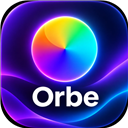
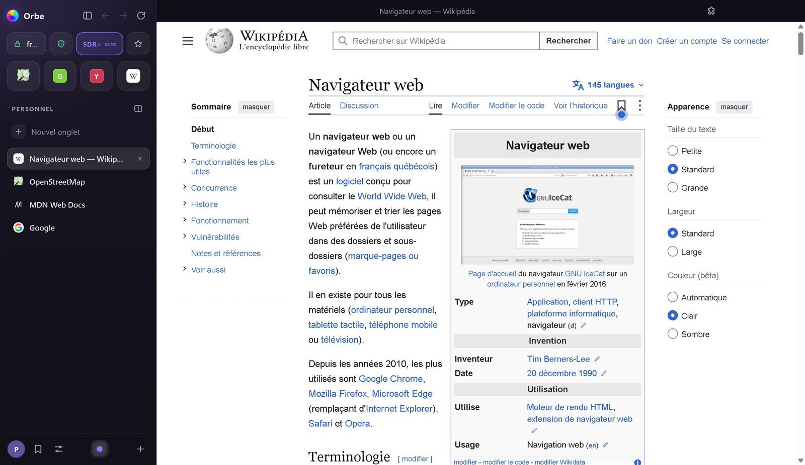
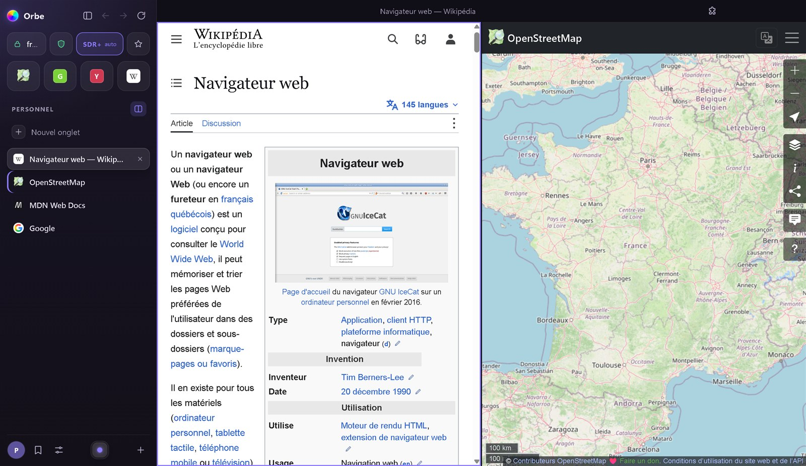
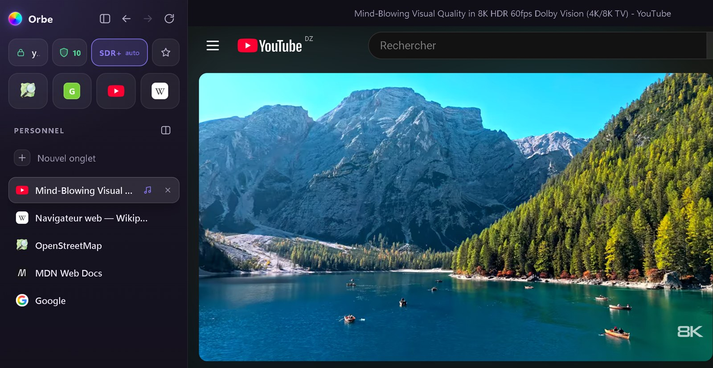
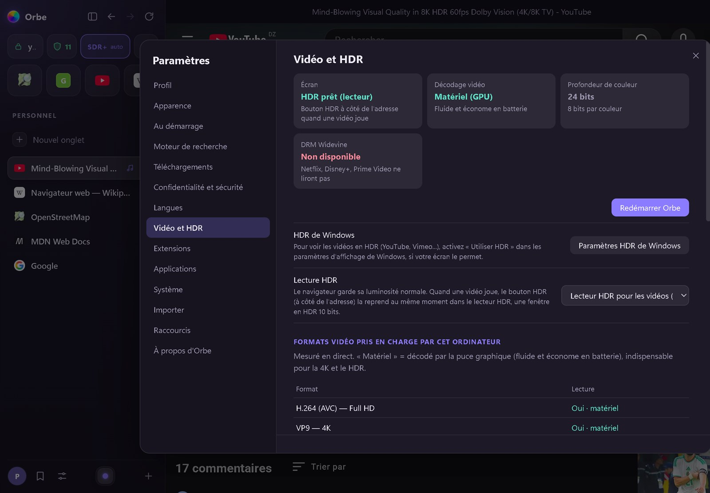
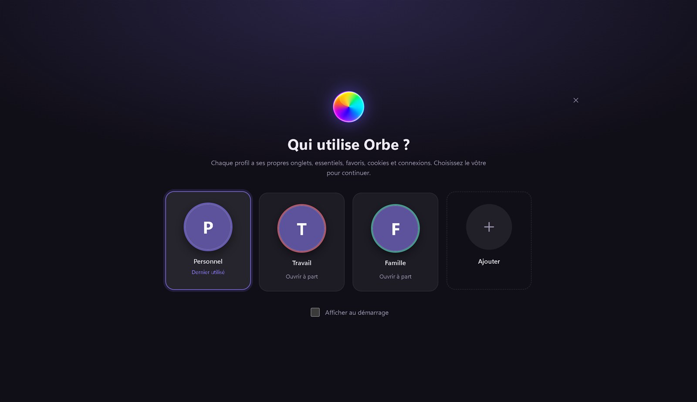
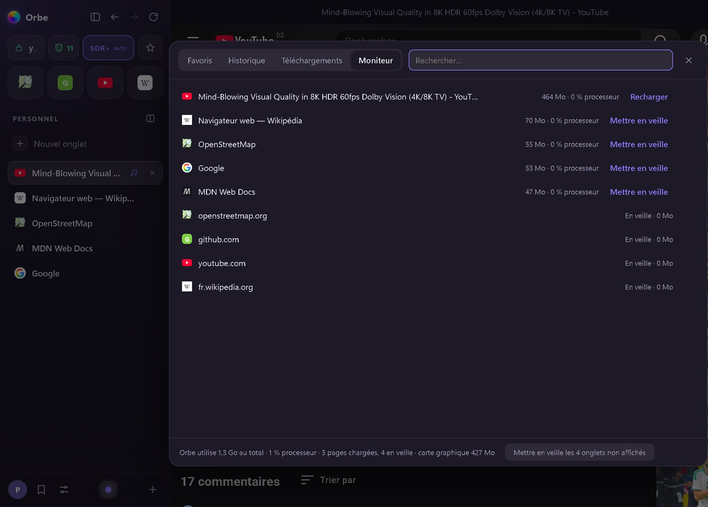
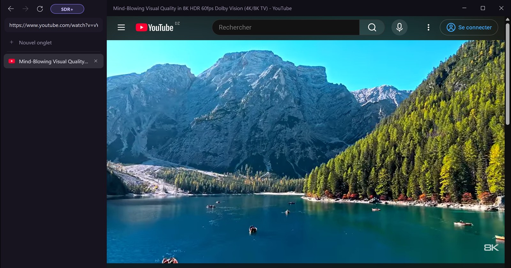

  

<h1 align="center">Orbe</h1>

  <b>Le navigateur à onglets verticaux pour Windows : rapide, soigné, et fait pour les vidéos en HDR.</b> 
  Natif ARM64 (Snapdragon X) et x64 (Intel, AMD) · en français · sans compte

  
  
  

  <a href="https://github.com/newsmangasfr/orbe-releases/releases/latest"><b>⬇ Télécharger Orbe</b></a>

---

## Télécharger

Ouvrez la **[dernière version](https://github.com/newsmangasfr/orbe-releases/releases/latest)** et choisissez l'installeur de votre PC :

| Votre PC | Fichier |
|---|---|
| Processeur ARM (Snapdragon X Elite / Plus, Windows on ARM) | `Orbe-Setup-<version>-arm64.exe` |
| Processeur Intel ou AMD | `Orbe-Setup-<version>-x64.exe` |

Pour savoir lequel prendre : **Paramètres Windows › Système › Informations système › Type de système**.

**Installation :** lancez le fichier téléchargé. L'installeur n'est pas encore signé : si Windows affiche « Windows a protégé votre ordinateur », cliquez sur **Informations complémentaires**, puis **Exécuter quand même**.

**Mises à jour :** Orbe les trouve et les installe tout seul, depuis ce dépôt. Avant d'installer, il vérifie l'empreinte SHA-256 de l'installeur, et il sauvegarde vos profils.

---

## Ce qu'Orbe sait faire

### Onglets verticaux et essentiels
- Les onglets sont rangés dans une **barre latérale**, que l'on peut masquer : elle réapparaît quand la souris touche le bord gauche.
- **Essentiels** : vos sites favoris en tuiles, toujours ouverts, jusqu'à 12 (4 par rangée). On les ajoute en glissant un onglet. Ils peuvent aussi s'afficher en haut de la fenêtre.
- **Espaces** pour séparer vos sujets, groupes d'onglets, onglets rangés automatiquement quand ils ne servent plus.
- **Barre de commande** (Ctrl K) pour tout trouver : onglets, favoris, historique, actions.

### Vue partagée
Deux pages côte à côte dans la même fenêtre (Ctrl Maj D).

### Vidéos : HDR intelligent et noirs profonds
- **HDR automatique** : pas besoin d'activer le HDR dans Windows. Quand une vidéo existe en HDR, Orbe l'ouvre dans son lecteur HDR et allume le HDR de l'écran le temps de la vidéo, puis le remet comme avant.
- Un **badge vidéo** apparaît en haut à droite, à côté des extensions, dès qu'une vidéo démarre : **HDR**, **SDR+** (SDR aux noirs profonds) ou **SDR**.
- **HDR adaptatif** : Orbe mesure la marge HDR de votre écran (luminosité maximale ÷ blanc SDR de Windows) et choisit, page par page, la version de la vidéo qui sera la plus belle. Il refait la mesure quand vous revenez dans Orbe ou changez d'écran.
- **Noirs profonds (SDR+)** : quand le HDR de Windows est activé, Windows grise les ombres des vidéos SDR. Orbe les corrige (gamma 2.2) sur la vidéo seulement, jamais sur les vidéos HDR.
- Décodage par la puce graphique (AV1, VP9, HEVC, H.264) : fluide et économe en batterie.

### Profils
Chaque profil a ses propres onglets, essentiels, favoris, cookies et connexions. Changez de profil d'un clic, ou ouvrez-en un dans une **fenêtre à part**, à côté du premier. L'écran « Qui utilise Orbe ? » peut s'afficher au démarrage.

### Moniteur des onglets
Mémoire et processeur de chaque onglet, en direct (Maj Échap). Mettez en veille un onglet, ou tous ceux qui ne sont pas affichés, d'un clic. Au démarrage, seuls les onglets affichés se chargent.

### Et aussi
- **Extensions Chrome** depuis le Chrome Web Store, avec leurs boutons en haut à droite (menu puzzle pour choisir celles qui restent visibles).
- **Bloqueur de publicités et de traqueurs** intégré, avec exceptions par site.
- **Import** des favoris et de l'historique depuis Chrome, Edge, Brave, Firefox et d'autres.
- **Sauvegardes automatiques** des profils, et restauration en un clic.
- **Rapport de plantage local** : si une page ou Orbe plante, le journal garde ce qui s'est passé, sur votre ordinateur seulement.
- **Vidéo Nomade** : la petite fenêtre vidéo (image dans l'image) vous suit sur tous vos bureaux et, quand la souris arrive dessus, part vers la meilleure place de l'écran (un coin ou le milieu d'un bord) pour vous laisser travailler. Alt pour la garder ; Alt une seconde : Espace pour pause, ← → pour 10 secondes, molette pour la taille.
- Mini-fenêtre, téléchargements, recherche dans la page, thèmes clair et sombre.
- Moteur de recherche au choix : Google, DuckDuckGo, Bing, Qwant, Ecosia, Brave Search.

---

## Raccourcis clavier

| Raccourci | Action | Raccourci | Action |
|---|---|---|---|
| `Ctrl T` | Nouvel onglet | `Ctrl Maj T` | Rouvrir l'onglet fermé |
| `Ctrl W` | Fermer l'onglet | `Ctrl L` | Modifier l'adresse |
| `Ctrl D` | Épingler l'onglet | `Ctrl Maj D` | Vue partagée |
| `Ctrl K` | Barre de commande | `Ctrl \` | Masquer la barre latérale |
| `Ctrl Tab` | Onglet suivant | `Ctrl 1-9` | Changer d'espace |
| `Ctrl F` | Chercher dans la page | `Ctrl H` / `Ctrl J` | Historique / Téléchargements |
| `Ctrl Maj O` | Favoris | `Ctrl ,` | Paramètres |
| `Ctrl Alt N` | Mini-fenêtre | `Ctrl Maj C` | Copier le lien (sans pistage) |

La liste complète est dans **Paramètres › Raccourcis**.

---

## Vie privée

- **Pas de compte, pas de télémétrie.** Vos onglets, favoris, historique, profils et journaux restent sur votre ordinateur.
- Orbe ne contacte de lui-même que **GitHub**, pour les mises à jour, et le service de listes du bloqueur de publicités (**Ghostery**). Les autres connexions sont celles des sites que vous visitez, de votre moteur de recherche et du Chrome Web Store si vous installez une extension.
- « Interdire le suivi » et nettoyage des liens copiés sont disponibles dans les paramètres.

---

## Configuration requise

- Windows 10 ou 11, 64 bits.
- Processeur ARM64 ou x64.
- Pour les vidéos en HDR : un écran compatible HDR (Orbe allume le HDR de Windows tout seul pendant les vidéos HDR).

## Limites connues

- Les vidéos protégées par DRM (Netflix, Disney+, Prime Video) ne sont pas lisibles pour l'instant.
- L'installeur n'est pas encore signé (avertissement de Windows à l'installation).
- La version x64 est récente et a encore peu été testée sur de vrais PC Intel ou AMD.

---

## En préparation : Orbe natif

Une nouvelle version d'Orbe, réécrite en C++ avec une interface dessinée directement par Windows (Direct2D), est en préparation. Elle démarre environ trois fois plus vite, pèse moins d'un mégaoctet, et utilise le moteur Chromium déjà présent dans Windows. Elle n'est pas encore disponible au téléchargement.

---

## Versions

Les notes de chaque version sont dans **[Releases](https://github.com/newsmangasfr/orbe-releases/releases)**. Les plus récentes :

- **0.9.16** : barre Retour / Suivant / Actualiser, badge vidéo et extensions dans les fenêtres d'application ; badge vidéo plus fiable.
- **0.9.15** : Vidéo Nomade (8 places intelligentes, touche Alt, pause, ±10 s et taille à la molette).
- **0.9.14** : YouTube démarre du premier coup (plus de lecteur noir à la première ouverture), publicités toujours bloquées.
- **0.9.13** : image dans l'image sur tous les bureaux et qui s'écarte de la souris ; badge vidéo seulement pendant une vidéo.
- **0.9.12** : HDR automatique sans régler Windows, badge vidéo HDR / SDR+ / SDR à côté des extensions.
- **0.9.11** : paramètres Vidéo et HDR remis à jour, boutons « Redémarrer Orbe » affichés seulement quand il le faut.
- **0.9.10** : bouton vidéo HDR / SDR+ / SDR toujours visible, noirs profonds pour les vidéos SDR.
- **0.9.9** : Orbe existe aussi pour les PC Intel et AMD (x64).
- **0.9.8** : un profil peut s'ouvrir dans une fenêtre à part.
- **0.9.7** : écran « Qui utilise Orbe ? » et photos des profils.
- **0.9.6** : glisser un onglet vers les essentiels, grille de 4 par rangée, essentiels en haut au choix.

---

Ce dépôt contient les installeurs d'Orbe et leurs notes de version. Les captures ont été faites sur une installation de test.
